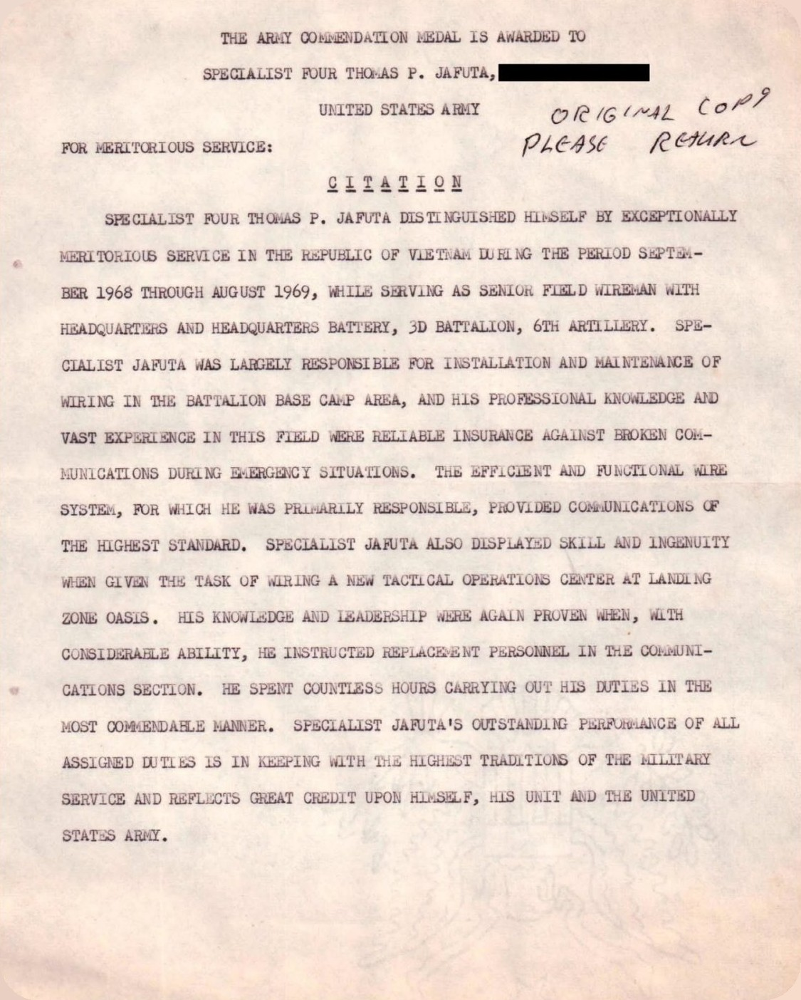
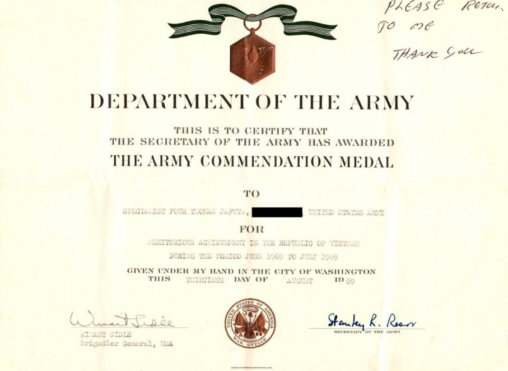

# His Army papers

Dad kept the papers for his Army Commendation Medal. The typed citation is for meritorious service from September 1968 to August 1969, the year of these letters. It names his job, senior field wireman, which explains the lines he was always fixing at night. The certificate, dated 30 August 1969, is for meritorious achievement in June and July 1969. The family says he received the medal twice; the papers for the other award are still being looked for.

The handwritten notes in the corners are Dad’s. His Social Security number has been blacked out.

## The citation

THE ARMY COMMENDATION MEDAL IS AWARDED TO SPECIALIST FOUR THOMAS P. JAFUTA, [number withheld], UNITED STATES ARMY, FOR MERITORIOUS SERVICE:

CITATION

SPECIALIST FOUR THOMAS P. JAFUTA DISTINGUISHED HIMSELF BY EXCEPTIONALLY MERITORIOUS SERVICE IN THE REPUBLIC OF VIETNAM DURING THE PERIOD SEPTEMBER 1968 THROUGH AUGUST 1969, WHILE SERVING AS SENIOR FIELD WIREMAN WITH HEADQUARTERS AND HEADQUARTERS BATTERY, 3D BATTALION, 6TH ARTILLERY. SPECIALIST JAFUTA WAS LARGELY RESPONSIBLE FOR INSTALLATION AND MAINTENANCE OF WIRING IN THE BATTALION BASE CAMP AREA, AND HIS PROFESSIONAL KNOWLEDGE AND VAST EXPERIENCE IN THIS FIELD WERE RELIABLE INSURANCE AGAINST BROKEN COMMUNICATIONS DURING EMERGENCY SITUATIONS. THE EFFICIENT AND FUNCTIONAL WIRE SYSTEM, FOR WHICH HE WAS PRIMARILY RESPONSIBLE, PROVIDED COMMUNICATIONS OF THE HIGHEST STANDARD. SPECIALIST JAFUTA ALSO DISPLAYED SKILL AND INGENUITY WHEN GIVEN THE TASK OF WIRING A NEW TACTICAL OPERATIONS CENTER AT LANDING ZONE OASIS. HIS KNOWLEDGE AND LEADERSHIP WERE AGAIN PROVEN WHEN, WITH CONSIDERABLE ABILITY, HE INSTRUCTED REPLACEMENT PERSONNEL IN THE COMMUNICATIONS SECTION. HE SPENT COUNTLESS HOURS CARRYING OUT HIS DUTIES IN THE MOST COMMENDABLE MANNER. SPECIALIST JAFUTA’S OUTSTANDING PERFORMANCE OF ALL ASSIGNED DUTIES IS IN KEEPING WITH THE HIGHEST TRADITIONS OF THE MILITARY SERVICE AND REFLECTS GREAT CREDIT UPON HIMSELF, HIS UNIT AND THE UNITED STATES ARMY.
