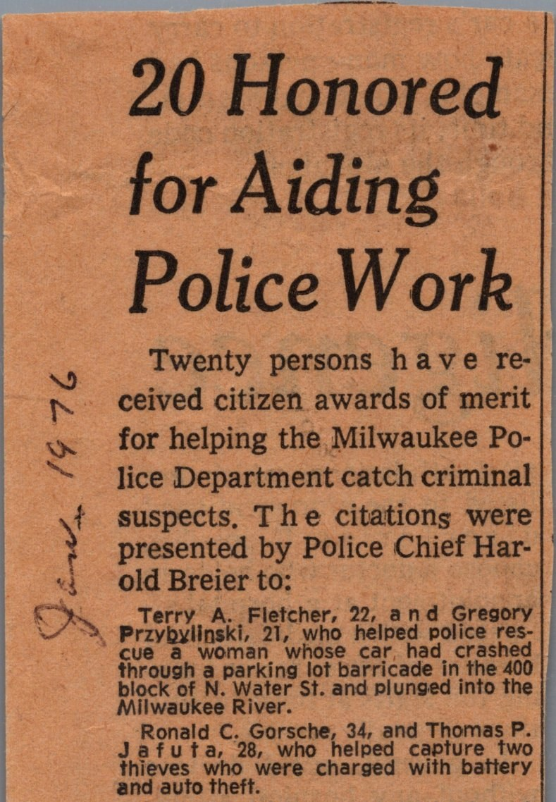
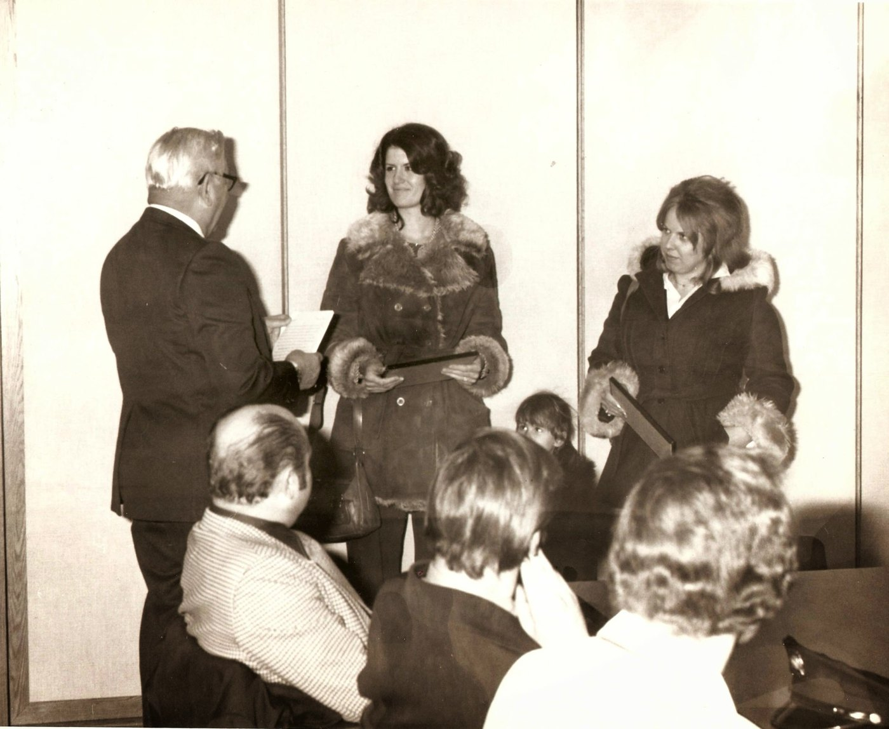

# Stories Dad told

*As Andy remembers them.*

## Now I Know What They Mean

*Ben Het, during the 1969 siege*

Mortars were coming in, and Dad was running across the battlefield when one landed really close. He pooped his pants, and then he started laughing as he ran. He jumped into the closest foxhole, and the guys stared at him, bewildered: he had nearly lost his life, and he was laughing. Then he told them, and the smell told them the rest.

“Now I know what they mean,” he said, “about having the shit scared out of you.”

*Dad rarely swore. — Andy*

## Nibble on This

*Andy’s account*

He was burned by his own flare while making a hasty advance towards the rear under enemy fire. Later one of the new guys, an NFG, was complaining about being hungry. Dad lifted up his arm where he had received the flare burn, likely third degree, and said, “nibble on this.”

## Good Citizens

*Milwaukee, 1976*

Back home in Milwaukee, two men chose the wrong car to steal gas from: Dad’s. He and his friend Ronnie “detained” them until the police arrived. The newspaper put it more formally: they “helped capture two thieves who were charged with battery and auto theft.” The details are best left to the imagination. The Milwaukee Police Department honored both with citizen awards of merit. Neither came to collect. Dad and Ronnie were at work, “committed to their jobs and paying the bills,” so Mom (Laura) and Bonnie, Ronnie’s wife, accepted the honors for them. Good citizenship, it seems, did not come with paid time off.

{.photo-half}
{.photo-half}
